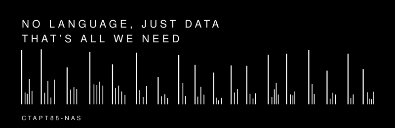

# Старт88-NAS

Мобильный гаджет для хранения данных объёмом до 32 терабайт

Персональная система надёжного хранения очень большого объёма данных, которую
можно положить даже в карман. Полноценный компьютер на базе 8-ядерного
процессора **RK3588** со встроенным NPU 6 TOPS, до 4× M.2 NVMe с поддержкой
RAID, встроенный ИБП, питание по PoE+ или Type-C PD. Пассивное охлаждение —
без вентиляторов.

## Особенности

- **До 32 ТБ** — 4× M.2 NVMe (до 8 ТБ на диск), RAID 0/1/5/6/10
- **NPU 6 TOPS** — нейросетевой ускоритель для Edge AI
- **Встроенный ИБП** (LiFePO₄, 18650, 4–10 Вт·ч) — опция, самостоятельная установка, безопасное автовыключение
- **Питание** — Type-C PD + 2× PoE+ (до 30 Вт) с автопереключением
- **Пассивное охлаждение** — корпус рассчитан на работу без вентиляторов; резервный 4-pin PWM разъём для внешнего
- **Дисплеи** — 1.29″ OLED (статус) в базовом корпусе; опционально сенсорный 5″ и больше (MIPI-DSI, отдельная плата) для другого исполнения
- **Низкое потребление** — 6–10 Вт, работает от Power Bank или Ethernet
- **Local-First** — полный доступ к данным без облака и интернета
- **Открытое ПО** — OpenMediaVault, Nextcloud и другие проекты на базе Linux
- **Открытое железо** — схемы и документация в репозитории (раздел [hardware](hardware/sch/README.md))

## Варианты применения

- Компактный NAS с поддержкой M.2 NVME, объединённых в RAID
- Тонкий клиент со встроенным NPU ускорителем в форм-факторе меньше внешнего бокса для HDD
- Мобильный AI ассистент на основе открытых проектов типа OpenClaw
- Регистратор для смарт-камер с функцией машинного зрения

## Спецификация

| Параметр | Значение |
|----------|----------|
| Процессор + NPU | 8 ядер (4×A76 + 4×A55), NPU 6 TOPS (INT8/FP16) |
| Оперативная память | LPDDR4x до 32 ГБ |
| Загрузочный раздел | eMMC 8–128 ГБ |
| Диски | 4× M.2 M-key 2280 NVMe (2× PCIe Gen3 x2 + 2× PCIe Gen2 x1), до 8 ТБ на диск |
| Сетевые интерфейсы | 2× GbE Ethernet (PoE+), M.2 E-key WiFi + BT |
| Дисплей | 1.29″ OLED (I²C, статус) в базовом корпусе; опционально 5″+ MIPI-DSI сенсорный (отдельная плата) |
| Кнопки и индикация | Power, Mode, Set (внешние), Reset (внутренний); Power/User LED, buzzer |
| Другие интерфейсы | 2× USB 3.1, HDMI 2.1, MicroSD, NFC, CAN, отладочный UART |
| Питание | Type-C PD, 2× PoE+; ИБП LiFePO₄ — опция, самостоятельная установка |
| Видео и ISP | 8K @ 60 Гц, ISP 32 Мп, HDR |
| Корпус | Алюминий МДО, 130 × 94 × 28.5 мм |
| Охлаждение | Пассивное; резервный 4-pin PWM разъём для внешнего вентилятора |
| Условия эксплуатации | −20 … +50 °C, 15–90 % (без конденсации) |
| Операционная система | Linux 6.11 и выше |

Подробная спецификация — в [hardware/sch/README.md](hardware/sch/README.md).

## Программное обеспечение

Старт88-NAS работает под управлением **OpenMediaVault** — операционной системы
с открытым исходным кодом на базе Debian Linux. Из коробки поддерживает
SMB/CIFS, FTP, SFTP, SSH и Rsync; расширяется плагинами, администрируется
через браузер. Поддерживаются также Nextcloud и другие открытые проекты.

Устройство является частью семейства
[Pixelnas](https://pixelnas.com) и помогает реализовать стратегию 3-2-1:
минимум три копии данных на двух разных носителях и в одном облаке.

## Структура репозитория

| Папка | Назначение |
|-------|-----------|
| `media/` | Рекламные и презентационные материалы |
| `hardware/sch/` | Принципиальные схемы и блок-диаграммы |
| `hardware/components/` | Datasheets и данные на компоненты |
| `3d/` | 3D-модели корпуса и деталей |