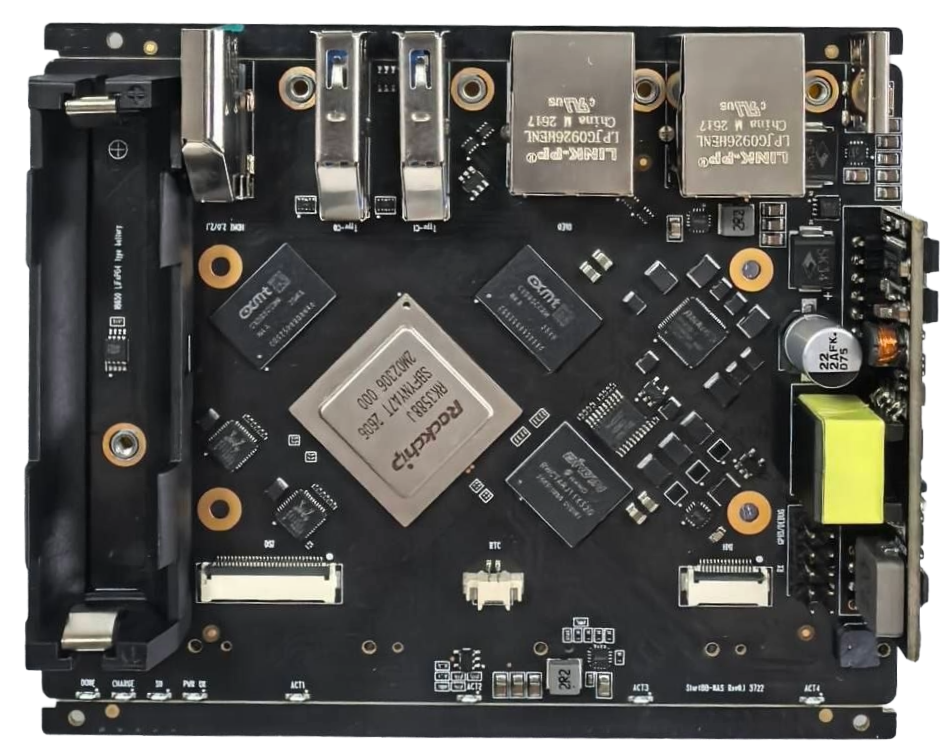
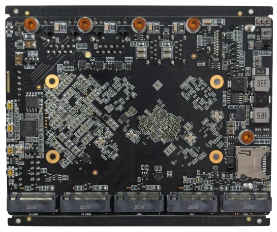

# Презентации

[Просмотр презентации](Start88-NAS-UberNAS-community-edition.pdf)

## Фото платы

Сверху платы — батарея, интерфейсные разъёмы, PoE+ модуль и процессор с памятью для отвода тепла на верхнюю крышку.

Снизу платы — разъёмы дисков и модуля WiFi.

